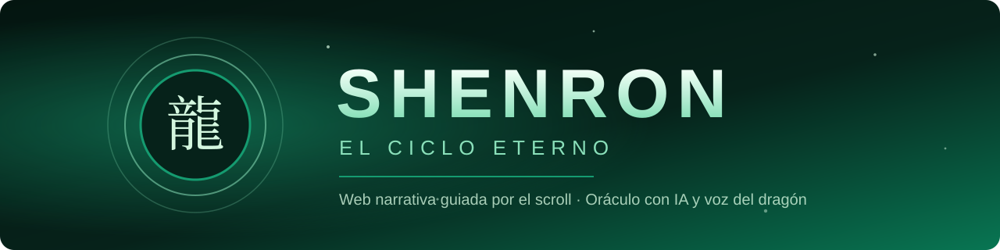
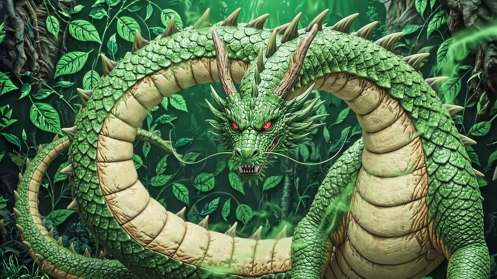
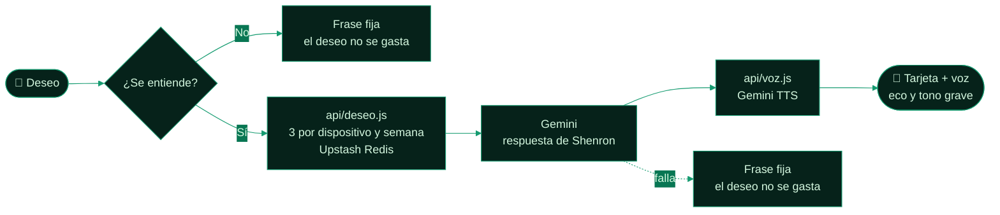

<p align="center">
  <a href="https://shenronwebsite.vercel.app">
    
  </a>
</p>

<p align="center">
  <a href="https://shenronwebsite.vercel.app"></a>
</p>

<p align="center">
  
  
  
  
  
  
  
  
  
</p>

<p align="center">
  <i>Web narrativa de una sola página donde el fondo avanza con el scroll.<br>
  Al final espera el Oráculo: pide un deseo y el dragón te responde con su propia voz.</i>
</p>

<p align="center">
  <a href="https://shenronwebsite.vercel.app">
    
  </a>
</p>

> [!NOTE]
> Proyecto de fans sin ánimo de lucro. Dragon Ball y Shenron pertenecen a sus respectivos titulares; esta web no tiene relación con ellos.

---

## 🐉 Qué hace

<table>
  <tr>
    <td width="50%" valign="top">
      <h3>🎞️ Animación guiada por el scroll</h3>
      433 fotogramas WebP (1280×720, unos 80 KB cada uno) dibujados en un <code>&lt;canvas&gt;</code>. El fotograma que se muestra depende de la posición de la página.
    </td>
    <td width="50%" valign="top">
      <h3>⏳ Carga progresiva</h3>
      Descarga los fotogramas en paralelo (8 a la vez) y por pasadas: primero uno de cada 16, luego uno de cada 8, y así hasta completarlos, para que todo el recorrido tenga imagen cuanto antes. La pantalla de carga dura al menos 2,5 s y se retira cuando ha llegado uno de cada 8 fotogramas; el resto sigue cargando y, si falta uno, se usa el más cercano disponible.
    </td>
  </tr>
  <tr>
    <td valign="top">
      <h3>📼 Vídeo de respaldo</h3>
      En móviles táctiles pequeños, con conexión lenta o ahorro de datos, y si los fotogramas no llegan, usa un vídeo en bucle en lugar de la secuencia. Antes muestra un aviso con el motivo, que se cierra con «Entendido» y no vuelve a salir durante la sesión.
    </td>
    <td valign="top">
      <h3>✨ Partículas y aparición</h3>
      Partículas luminosas en un segundo canvas que se acercan al puntero; con <code>prefers-reduced-motion</code> se quedan quietas. Las secciones aparecen con <code>IntersectionObserver</code>.
    </td>
  </tr>
</table>

## 🔮 El Oráculo

El visitante pide un deseo y Shenron responde en primera persona con un texto generado por Gemini (Google), que aparece letra a letra en una tarjeta superpuesta. Después lo pronuncia en voz alta: la voz se genera con Gemini TTS y el navegador le aplica un efecto de dragón (tono más grave y eco con Web Audio).



| | |
|---|---|
| 🎟️ **Tres deseos por semana** | Se cuentan por dispositivo con una cookie técnica en Upstash Redis, aunque varias personas compartan WiFi, con un tope de 9 por red para evitar abusos. Los identificadores se guardan seudonimizados con HMAC. |
| 🔊 **Voz del dragón** | Se puede silenciar y la preferencia se recuerda. Si la voz no está disponible, la respuesta aparece sin voz. |
| 🌀 **Deseos que no entiende** | Un deseo vacío, solo con signos, solo con números o con letras que no forman palabras («asdf», «xkqzv») se detecta antes de llamar a Gemini: Shenron contesta con una frase fija y el deseo no se gasta. Si es Gemini quien no lo entiende, también responde con una frase fija, pero ese deseo sí cuenta. |
| 🛡️ **Respaldo y topes** | Si la IA no responde, el deseo no se gasta y se usan frases fijas. Un tope diario de llamadas a Gemini y otro de audios, entre todos los visitantes, protegen el plan gratuito. |
| 🟠 **Las siete esferas** | Al cerrar la tarjeta del tercer deseo, las esferas se dispersan, un estallido de luz cubre la pantalla y la página vuelve al inicio. |

## 🧩 Tecnología

HTML, CSS y JavaScript puro, sin framework ni dependencias de npm. Canvas 2D, `IntersectionObserver`, Network Information API, `<dialog>` nativo, `sessionStorage` y fuentes DM Sans y Manrope servidas desde la propia web. El Oráculo usa funciones serverless de Vercel que llaman por `fetch` a la API de Gemini y a la API REST de Upstash; la clave de Gemini solo vive en el servidor.

```
📄 index.html       estructura y contenido
📄 privacidad.html  política de privacidad
🎨 styles.css       estilos
⚙️ script.js        secuencia de fotogramas, partículas, revelado y oráculo
☁️ api/deseo.js     función serverless del Oráculo (Gemini + límite de deseos)
☁️ api/voz.js       función serverless de la voz de Shenron (Gemini TTS)
☁️ api/_comun.js    utilidades compartidas por las dos funciones
🖼️ assets/          fotogramas, póster, fuentes e imágenes del README
```

## 🚀 Ejecutar en local

```bash
python -m http.server 5173
```

Y abrir `http://localhost:5173`. Así el Oráculo no tiene servidor y responde con las frases fijas.

Para probar el Oráculo con IA, copia `.env.example` a `.env`, pon tus claves y arranca con Vercel CLI:

```bash
vercel dev
```

<p align="center"><sub>龍 · Una historia sobre lo que permanece</sub></p>
